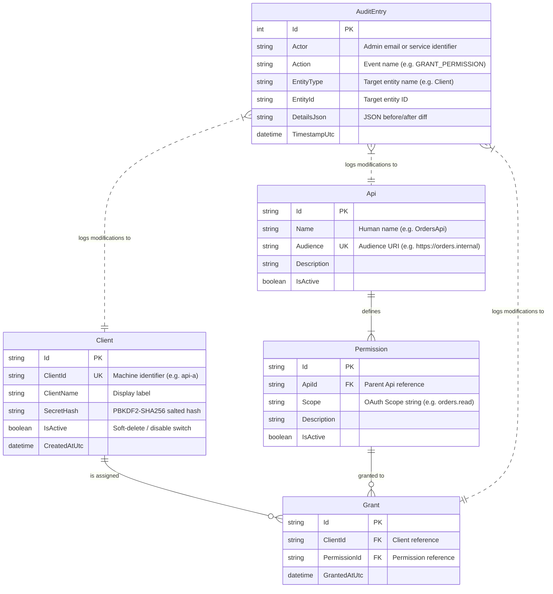

# Federated Identity: Data Model & Relationship Architecture

This document provides a comprehensive breakdown of the authorization database schema implemented in `AuthService`. It details each entity, its attributes, and the architectural rationales behind the relationships, constraints, and security decisions.

---

## 1. Entity-Relationship Overview

The schema is built around the OAuth 2.0 Client Credentials model (RFC 6749) and fine-grained Scope Authorization.



---

## 2. Detailed Entity Breakdown

### 2.1 `Client`
Represents an **autonomous calling application or service** (consumer/caller).

| Attribute | Data Type | Constraint | Purpose & Architectural Rationale |
|---|---|---|---|
| `Id` | `string` (UUID) | Primary Key | Internal surrogate key. Decouples relational integrity from external business IDs. |
| `ClientId` | `string` | Unique Index | Public identifier passed in `POST /oauth/token` (RFC 6749 §2.2). Must be unique across the tenant. |
| `ClientName` | `string` | Required | Human-readable name displayed in management portals and audit logs. |
| `SecretHash` | `string` | Required | **Security Critical**: We never store plain client secrets. A raw secret (e.g. `sec_abc123`) is hashed using **PBKDF2** (100,000 iterations, HMAC-SHA256, 128-bit cryptographically secure salt). Secrets are displayed **once** upon creation or rotation. |
| `IsActive` | `boolean` | Default `true` | Soft-disable switch. Disabling immediately halts token issuance and fails real-time `/check` queries without deleting relational history. |
| `CreatedAtUtc` | `DateTime` | UTC | Timestamp tracking registration date. |

---

### 2.2 `Api`
Represents a **Resource Server** (provider/producer) hosting protected HTTP routes.

| Attribute | Data Type | Constraint | Purpose & Architectural Rationale |
|---|---|---|---|
| `Id` | `string` (UUID) | Primary Key | Surrogate identifier for relational foreign keys. |
| `Name` | `string` | Required | Display name (e.g., `OrdersApi`, `InventoryApi`). |
| `Audience` | `string` | Unique Index | The URI identifier identifying the target service (e.g. `https://orders.internal`). Matches the standard OAuth `aud` claim (RFC 7519 §4.1.3). Resource servers compare incoming tokens against this value. |
| `Description` | `string` | Optional | Documentation describing what the API provides and its operational tier. |
| `IsActive` | `boolean` | Default `true` | When disabled, tokens will omit this API's audience and permissions from issuance. |

---

### 2.3 `Permission`
Represents a **named OAuth scope** declaring a specific capability or action on an API.

| Attribute | Data Type | Constraint | Purpose & Architectural Rationale |
|---|---|---|---|
| `Id` | `string` (UUID) | Primary Key | Surrogate key. |
| `ApiId` | `string` | Foreign Key → `Api.Id` | Enforces ownership. A permission cannot exist without an owning API. |
| `Scope` | `string` | Required | The claim value injected into the JWT `scope` claim (e.g. `orders.read`, `orders.write`). |
| `Description` | `string` | Optional | Human explanation of what rights this scope bestows. |
| `IsActive` | `boolean` | Default `true` | Flag to deprecate or suspend a specific scope without modifying client grants. |

**Unique Constraint**: `UNIQUE(ApiId, Scope)`. Prevents an API from registering duplicate scope definitions.

---

### 2.4 `Grant`
The **Many-to-Many Join Table** binding a `Client` to a `Permission`.

| Attribute | Data Type | Constraint | Purpose & Architectural Rationale |
|---|---|---|---|
| `Id` | `string` (UUID) | Primary Key | Surrogate key for specific grant instance identification. |
| `ClientId` | `string` | Foreign Key → `Client.Id` | The client being authorized. |
| `PermissionId` | `string` | Foreign Key → `Permission.Id` | The permission being granted. |
| `GrantedAtUtc` | `DateTime` | UTC | Timestamp when the administrative grant was established. |

**Unique Composite Index**: `UNIQUE(ClientId, PermissionId)`. Prevents duplicate grant entries.

---

### 2.5 `AuditEntry`
An **append-only, immutable historical log** tracking all security-sensitive administrative mutations.

| Attribute | Data Type | Constraint | Purpose & Architectural Rationale |
|---|---|---|---|
| `Id` | `int` | Primary Key, Auto-Increment | Monotonically increasing sequencing identifier. |
| `Actor` | `string` | Required | Who performed the change (e.g. `alice.admin@internal`, `system`). Extracted from the verified OIDC ID token. |
| `Action` | `string` | Required | Standardized event verb (e.g. `CREATE_CLIENT`, `GRANT_PERMISSION`, `REVOKE_PERMISSION`, `ROTATE_SECRET`). |
| `EntityType` | `string` | Required | Target entity name (e.g. `Client`, `Grant`, `Permission`). |
| `EntityId` | `string` | Required | ID of the mutated record. |
| `DetailsJson` | `string` | Required | JSON payload recording before/after values or diffs for compliance auditing. |
| `TimestampUtc` | `DateTime` | UTC | Exact timestamp of the event. |

---

## 3. Key Architectural Decisions & Rationales

### Why are `Client` and `Api` Separated into Different Entities?
In naive designs, developers sometimes combine applications into a single `Service` table. We intentionally separated them because they fulfill **fundamentally different roles**:

1. **Consumer vs. Producer**:
   - A `Client` is an **active caller** holding authentication credentials (`client_secret`), requesting tokens, and sending requests.
   - An `Api` is a **passive resource server** holding an `Audience` URI and declaring route permissions.
2. **Dual-Role Services**:
   - A service like `OrdersApi` acts as an **Api** when accepting client orders, but acts as a **Client** when calling `CustomersApi` or `InventoryApi`.
   - Separating the entities allows the same physical codebase to have a `Client` registration for outgoing calls and an `Api` registration for incoming endpoints, without conflating credentials and permissions.

---

### Why Hierarchical Scope Ownership (`Api` → `Permission`)?
Instead of a flat global pool of scopes, scopes are explicitly children of an `Api`:

```
Api (OrdersApi, aud: https://orders.internal)
 └── Permission (orders.read)
 └── Permission (orders.write)
```

**Benefits**:
- **Namespace Collision Prevention**: Prevents different teams from inadvertently redefining generic scopes like `read` or `admin`.
- **Automatic Audience Resolution**: When a client requests a token, `AuthService` queries its grants, navigates `Grant → Permission → Api`, and automatically populates the `aud` claim with every target audience the client is allowed to touch:
  ```csharp
  var allowedAudiences = activeGrants
      .Select(g => g.Permission!.Api!.Audience)
      .Distinct()
      .ToList();
  ```
  If a client has zero permissions on `CustomersApi`, `https://customers.internal` is never included in the token's audience, causing `CustomersApi` to reject requests with 401 Unauthorized immediately.

---

### Why `Grant` is Explicitly Deleted (No `IsActive` on Grants)
Notice that while `Client`, `Api`, and `Permission` have an `IsActive` flag, `Grant` does not:
- **State Semantics**: Authorization is binary. An application either holds a grant or it does not.
- **Relational Cleanliness**: Revoking access deletes the `Grant` record entirely.
- **Audit Preservation**: Even though the row is deleted from `Grants`, the revocation event is permanently immortalized in the append-only `AuditEntries` table with full diff details and the administrator's identity.

---

### Soft-Delete Pattern on Principals (`IsActive`)
Instead of deleting a `Client` or `Api`:
- We set `IsActive = false`.
- **Security Justification**: Hard-deleting a client would either orphan past audit references or trigger cascading deletes that destroy historical audit trails. Soft-disabling freezes the client immediately while preserving relational integrity.

---

### Security by Design: Credential Storage
- **Zero Plaintext Secrets**: The database never stores raw client secrets.
- **PBKDF2 Hashing**: We use `Rfc2898DeriveBytes.Pbkdf2` with 100,000 iterations and SHA-256. If the database file is ever leaked or backed up insecurely, secrets cannot be reversed or cracked via precomputed rainbow tables.
