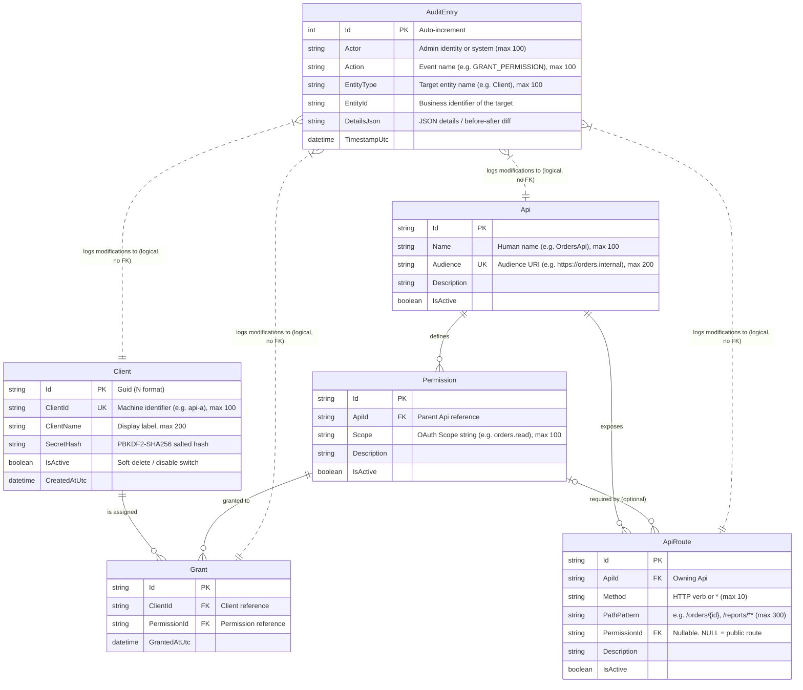

# Federated Identity: Data Model & Relationship Architecture

This document provides a comprehensive breakdown of the authorization database schema implemented in `AuthService`. It details each entity, its attributes, and the architectural rationales behind the relationships, constraints, and security decisions.

---

## 1. Entity-Relationship Overview

The schema is built around the OAuth 2.0 Client Credentials model (RFC 6749), fine-grained Scope Authorization, and **route-level access control**: each API registers the HTTP routes it exposes and the permission (scope) each route requires. The runtime `/check` endpoint and the Admin UI access simulator both evaluate against these routes with a **default-deny** policy.

The model has six entities: `Client`, `Api`, `Permission`, `ApiRoute`, `Grant` and `AuditEntry`.



---

## 2. Detailed Entity Breakdown

### 2.1 `Client`
Represents an **autonomous calling application or service** (consumer/caller).

| Attribute | Data Type | Constraint | Purpose & Architectural Rationale |
|---|---|---|---|
| `Id` | `string` (GUID, `N` format) | Primary Key | Internal surrogate key. Decouples relational integrity from external business IDs. |
| `ClientId` | `string` | Unique Index, Required, max 100 | Public identifier passed in `POST /oauth/token` (RFC 6749 §2.2). Must be unique across the tenant. |
| `ClientName` | `string` | Required, max 200 | Human-readable name displayed in management portals and audit logs. |
| `SecretHash` | `string` | Required | **Security Critical**: We never store plain client secrets. A raw secret (e.g. `sec_abc123`) is hashed using **PBKDF2** (100,000 iterations, HMAC-SHA256, 128-bit cryptographically secure salt). Secrets are displayed **once** upon creation or rotation. |
| `IsActive` | `boolean` | Default `true` | Soft-disable switch. Disabling immediately halts token issuance and fails real-time `/check` queries without deleting relational history. |
| `CreatedAtUtc` | `DateTime` | UTC | Timestamp tracking registration date. |

---

### 2.2 `Api`
Represents a **Resource Server** (provider/producer) hosting protected HTTP routes.

| Attribute | Data Type | Constraint | Purpose & Architectural Rationale |
|---|---|---|---|
| `Id` | `string` (UUID) | Primary Key | Surrogate identifier for relational foreign keys. |
| `Name` | `string` | Required, max 100 | Display name (e.g., `OrdersApi`, `InventoryApi`). |
| `Audience` | `string` | Unique Index, Required, max 200 | The URI identifier identifying the target service (e.g. `https://orders.internal`). Matches the standard OAuth `aud` claim (RFC 7519 §4.1.3). Resource servers compare incoming tokens against this value. |
| `Description` | `string` | Optional | Documentation describing what the API provides and its operational tier. |
| `IsActive` | `boolean` | Default `true` | When disabled, route checks against this API are denied ("not registered or is inactive"), and its permissions no longer count as live grants. |

**Navigation**: `Api.Permissions` (1:N, cascade delete) and `Api.Routes` (1:N, cascade delete).

---

### 2.3 `Permission`
Represents a **named OAuth scope** declaring a specific capability or action on an API.

| Attribute | Data Type | Constraint | Purpose & Architectural Rationale |
|---|---|---|---|
| `Id` | `string` (UUID) | Primary Key | Surrogate key. |
| `ApiId` | `string` | Foreign Key → `Api.Id` | Enforces ownership. A permission cannot exist without an owning API. |
| `Scope` | `string` | Required, max 100 | The claim value injected into the JWT `scope` claim (e.g. `orders.read`, `orders.write`). |
| `Description` | `string` | Optional | Human explanation of what rights this scope bestows. |
| `IsActive` | `boolean` | Default `true` | Flag to deprecate or suspend a specific scope without modifying client grants. |

**Unique Constraint**: `UNIQUE(ApiId, Scope)`. Prevents an API from registering duplicate scope definitions.

**Relationships**: `Permission.ApiId → Api.Id` (cascade delete). A permission is also referenced by `Grant` (cascade delete) and optionally by `ApiRoute` (restrict delete, see below).

---

### 2.4 `ApiRoute`
Represents a **route (HTTP method + path pattern) exposed by an `Api`**, and the `Permission` a client must hold to call it. Routes are the unit that `/check` evaluates.

| Attribute | Data Type | Constraint | Purpose & Architectural Rationale |
|---|---|---|---|
| `Id` | `string` (GUID, `N` format) | Primary Key | Surrogate key. |
| `ApiId` | `string` | Foreign Key → `Api.Id`, Required | Owning API. Routes are deleted with their API (cascade). |
| `Method` | `string` | Required, max 10 | Upper-case HTTP method (`GET`, `POST`, `PUT`, `PATCH`, `DELETE`, `HEAD`, `OPTIONS`) or `*` for any method. Normalized on write. |
| `PathPattern` | `string` | Required, max 300 | Path pattern. Supports literal segments (`/orders/export`), named parameters (`/orders/{id}`), single-segment wildcard (`/orders/*`), and a trailing catch-all (`/reports/**`, matches zero or more remaining segments). Normalized on write. |
| `PermissionId` | `string?` | Nullable Foreign Key → `Permission.Id` | The permission required to call this route. **`NULL` means the route is public**: any known, active client may call it. The permission must belong to the same `Api` (validated by the admin endpoint). Delete behavior is **Restrict**, so a permission that is still referenced by a route cannot be hard-deleted. |
| `Description` | `string` | Optional | Human explanation of what the route does. |
| `IsActive` | `boolean` | Default `true` | Disabled routes are ignored by matching, so they behave as if not registered (default-deny). |

**Unique Composite Index**: `UNIQUE(ApiId, Method, PathPattern)`. Prevents duplicate route definitions per API.

**Matching rules** (`RoutePatternMatcher` / `RouteAccessEvaluator`):
- Only active routes whose method equals the request method (or is `*`) are candidates.
- The **most specific** matching pattern wins. Scoring per segment: literal (100) > `{param}` (10) > `*` (5) > `**` (1).
- On a specificity tie, a route with an **exact method** beats a `*` method route.

---

### 2.5 `Grant`
The **Many-to-Many Join Table** binding a `Client` to a `Permission`.

| Attribute | Data Type | Constraint | Purpose & Architectural Rationale |
|---|---|---|---|
| `Id` | `string` (UUID) | Primary Key | Surrogate key for specific grant instance identification. |
| `ClientId` | `string` | Foreign Key → `Client.Id` (cascade delete) | The client being authorized. Note this references the surrogate `Client.Id`, not the public `Client.ClientId`. |
| `PermissionId` | `string` | Foreign Key → `Permission.Id` (cascade delete) | The permission being granted. |
| `GrantedAtUtc` | `DateTime` | UTC | Timestamp when the administrative grant was established. |

**Unique Composite Index**: `UNIQUE(ClientId, PermissionId)`. Prevents duplicate grant entries.

---

### 2.6 `AuditEntry`
An **append-only, immutable historical log** tracking all security-sensitive administrative mutations. It has **no foreign keys**: it references targets logically by business identifier, so history survives even if the target rows change.

| Attribute | Data Type | Constraint | Purpose & Architectural Rationale |
|---|---|---|---|
| `Id` | `int` | Primary Key, Auto-Increment | Monotonically increasing sequencing identifier. |
| `Actor` | `string` | Required, max 100, default `system` | Who performed the change. Supplied by the Admin UI in the request body (`Actor`), falling back to `admin`; the database seeder uses `system-seeder`. |
| `Action` | `string` | Required, max 100 | Standardized event verb. See the action catalog below. |
| `EntityType` | `string` | Required, max 100 | Target entity type: `Client`, `Api`, `Permission`, `Route`, `Grant`, or `System`. |
| `EntityId` | `string` | Required | **Business identifier** of the mutated record (not the surrogate GUID). See the table below. |
| `DetailsJson` | `string` | Required | JSON payload recording the change details or before/after values for compliance auditing. |
| `TimestampUtc` | `DateTime` | UTC | Exact timestamp of the event. |

**Audit action catalog**:

| `Action` | `EntityType` | `EntityId` format |
|---|---|---|
| `INITIAL_SEED` | `System` | `seed` |
| `CREATE_CLIENT` | `Client` | `ClientId` |
| `ENABLE_CLIENT` / `DISABLE_CLIENT` | `Client` | `ClientId` |
| `ROTATE_SECRET` | `Client` | `ClientId` |
| `CREATE_API` / `UPDATE_API` | `Api` | `Audience` |
| `CREATE_PERMISSION` / `UPDATE_PERMISSION` | `Permission` | `Scope` |
| `CREATE_ROUTE` / `UPDATE_ROUTE` | `Route` | `{Audience}:{METHOD} {PathPattern}` (details include `Before` / `After` snapshots) |
| `GRANT_PERMISSION` / `REVOKE_PERMISSION` | `Grant` | `{ClientId}:{Scope}` |

The Admin UI audit view returns the most recent 100 entries, newest first.

---

## 3. Key Architectural Decisions & Rationales

### Why are `Client` and `Api` Separated into Different Entities?
In naive designs, developers sometimes combine applications into a single `Service` table. We intentionally separated them because they fulfill **fundamentally different roles**:

1. **Consumer vs. Producer**:
   - A `Client` is an **active caller** holding authentication credentials (`client_secret`), requesting tokens, and sending requests.
   - An `Api` is a **passive resource server** holding an `Audience` URI and declaring route permissions.
2. **Dual-Role Services**:
   - A service like `OrdersApi` acts as an **Api** when accepting client orders, but acts as a **Client** when calling `CustomersApi` or `InventoryApi`.
   - Separating the entities allows the same physical codebase to have a `Client` registration for outgoing calls and an `Api` registration for incoming endpoints, without conflating credentials and permissions.

---

### Route-Level, Default-Deny Authorization (`ApiRoute`)
Scopes alone say *what a client may hold*; routes say *what each endpoint requires*. `RouteAccessEvaluator` is the **single source of truth** shared by the runtime `POST /check` and the Admin UI `check-access` simulator, so the simulation cannot drift from real behavior.

A request is **allowed only if all of these hold**:
1. The `Client` exists and is active.
2. An audience is supplied and resolves to a registered, active `Api`.
3. The request method + path matches an **active** `ApiRoute` of that API (otherwise: *denied by default*).
4. Either the route is **public** (`PermissionId IS NULL`), or the route's `Permission` is active **and** the client holds a live `Grant` for it.

A grant is **live** only when both its `Permission` and that permission's `Api` are active. Disabling a permission or API therefore takes effect immediately without touching any `Grant` rows.

---

### Why Hierarchical Scope Ownership (`Api` → `Permission`)?
Instead of a flat global pool of scopes, scopes are explicitly children of an `Api`:

```
Api (OrdersApi, aud: https://orders.internal)
 └── Permission (orders.read)
 └── Permission (orders.write)
```

**Benefits**:
- **Namespace Collision Prevention**: Prevents different teams from inadvertently redefining generic scopes like `read` or `admin`.
- **Automatic Audience Resolution**: When a client requests a token, `AuthService` queries its grants, navigates `Grant → Permission → Api`, and automatically populates the `aud` claim with every target audience the client is allowed to touch:
  ```csharp
    var allowedAudiences = activeGrants
      .Select(g => g.Permission!.Api!.Audience)
      .Distinct(StringComparer.OrdinalIgnoreCase)
      .ToList();
  ```
  If a client has zero permissions on `CustomersApi`, `https://customers.internal` is never included in the token's audience, causing `CustomersApi` to reject requests with 401 Unauthorized immediately.

---

### Why `Grant` is Explicitly Deleted (No `IsActive` on Grants)
Notice that while `Client`, `Api`, `Permission` and `ApiRoute` have an `IsActive` flag, `Grant` does not:
- **State Semantics**: Authorization is binary. An application either holds a grant or it does not.
- **Relational Cleanliness**: Revoking access deletes the `Grant` record entirely.
- **Audit Preservation**: Even though the row is deleted from `Grants`, the revocation event is permanently immortalized in the append-only `AuditEntries` table with full diff details and the administrator's identity.

---

### Soft-Delete Pattern on Principals (`IsActive`)
`Client`, `Api`, `Permission` and `ApiRoute` all carry `IsActive`. Instead of deleting a `Client` or `Api`:
- We set `IsActive = false`.
- **Security Justification**: Hard-deleting a client would either orphan past audit references or trigger cascading deletes that destroy historical audit trails. Soft-disabling freezes the client immediately while preserving relational integrity.

---

### Security by Design: Credential Storage
- **Zero Plaintext Secrets**: The database never stores raw client secrets.
- **PBKDF2 Hashing**: We use `Rfc2898DeriveBytes.Pbkdf2` with 100,000 iterations and SHA-256. If the database file is ever leaked or backed up insecurely, secrets cannot be reversed or cracked via precomputed rainbow tables.
