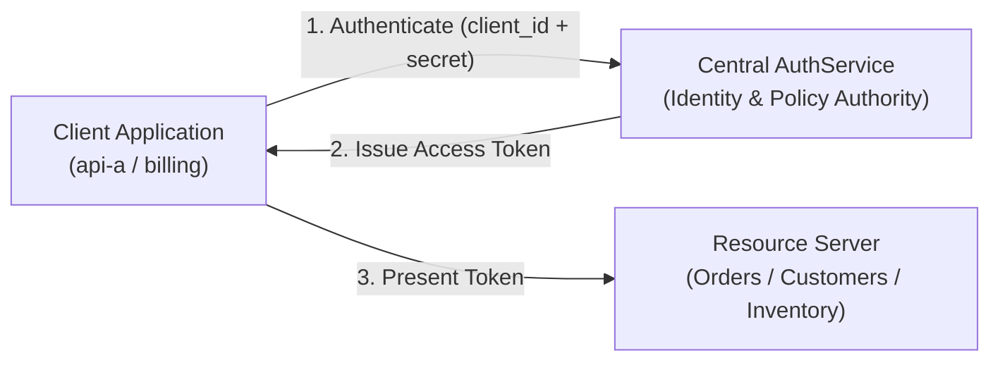
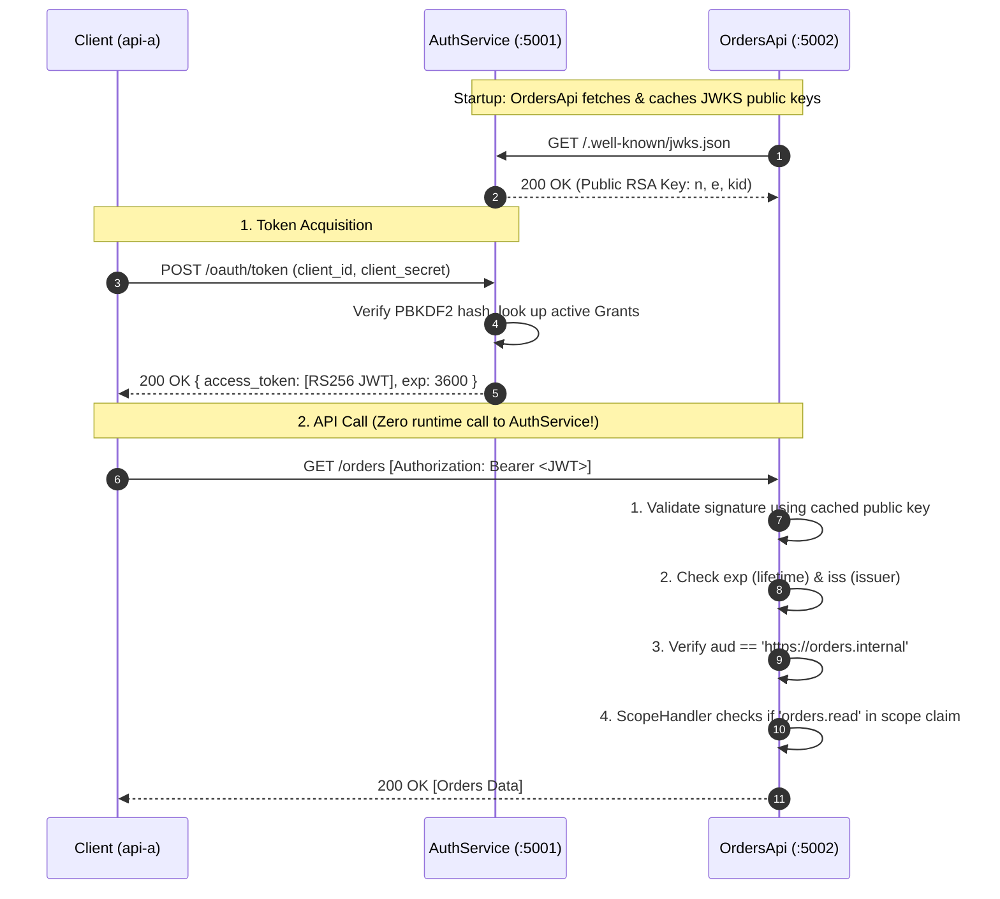
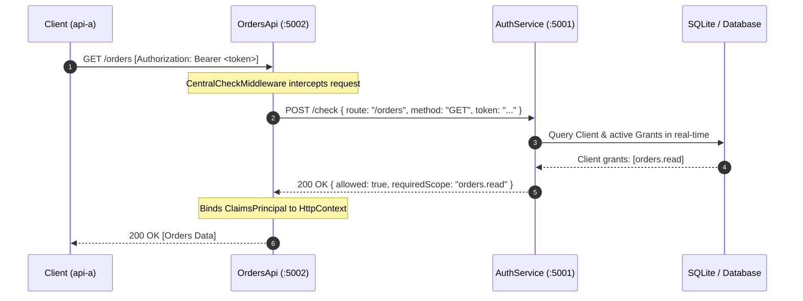
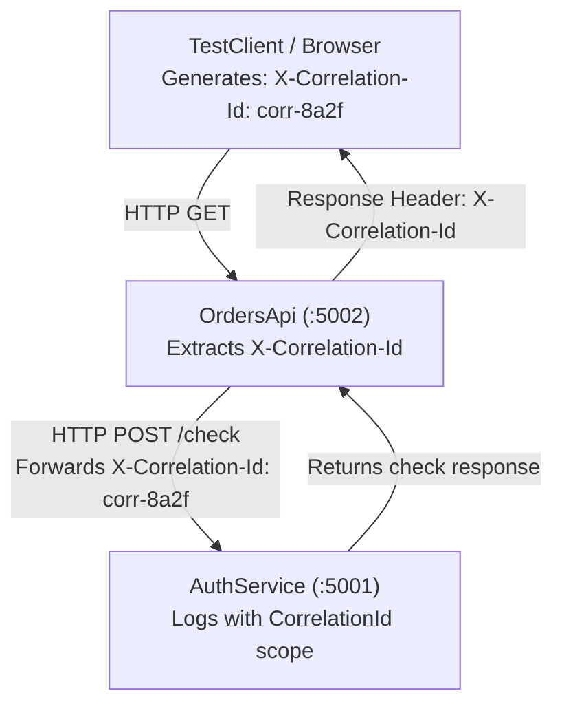

# Architectural Research: Federated Identity & Authorization Patterns

This document details the architecture, design choices, data flows, and security tradeoffs implemented in this project. It covers both decentralized token validation (Standard JWT mode) and centralized authorization evaluation (`/check` mode), as well as end-to-end request lifecycle and correlation tracing.

---

## Table of Contents
1. [Core Concepts & Roles](#1-core-concepts--roles)
2. [Architecture 1: Without Check (Decentralized JWT Bearer)](#2-architecture-1-without-check-decentralized-jwt-bearer)
3. [Architecture 2: With Check (Centralized Policy Evaluation)](#3-architecture-2-with-check-centralized-policy-evaluation)
4. [In-Depth Comparison & Tradeoff Matrix](#4-in-depth-comparison--tradeoff-matrix)
5. [End-to-End Request Lifecycle & Traceability](#5-end-to-end-request-lifecycle--traceability)
6. [The Instant Revocation Problem & Real-World Solutions](#6-the-instant-revocation-problem--real-world-solutions)
7. [Production Considerations](#7-production-considerations)

---

## 1. Core Concepts & Roles

In modern distributed microservice architectures, authentication and authorization are separated into two distinct concerns defined by the OAuth 2.0 (RFC 6749) and OpenID Connect specifications:

- **Client (`Caller`)**: A consuming service that initiates HTTP requests. Authenticates via client credentials grant (`client_id` + `client_secret`).
- **Authorization Server (`AuthService`)**: The trusted issuer. It holds the source of truth for clients, granted permissions, cryptographic keys (RSA-256), and audit history.
- **Resource Server (`Api`)**: Downstream services (OrdersApi, CustomersApi, InventoryApi) hosting protected endpoints that enforce route permissions.

---

## 2. Architecture 1: Without Check (Decentralized JWT Bearer)

This is the industry-standard OAuth 2.0 / OIDC architecture used by platforms like Auth0, Azure AD, and AWS Cognito.

### How Communication Works in this Mode:
1. **Public Key Discovery (JWKS)**: On startup or key cache miss, the Resource Server calls `GET /.well-known/jwks.json` from `AuthService` once and caches the RSA public key in memory.
2. **Local Cryptographic Validation**: When a request arrives with `Authorization: Bearer <JWT>`, the API decrypts the signature using the cached public key without calling `AuthService`.
3. **Audience Check (`aud`)**: ASP.NET Core checks if its URI (`https://orders.internal`) is present in the token's audience list. If not, it rejects with **401 Unauthorized**.
4. **Scope Authorization**: The route requirement (`RequireAuthorization("orders.read")`) inspects the token's `scope` claim. If missing, it returns **403 Forbidden**.

### Pros:
- **Maximum Performance & Scalability**: Resource servers validate requests entirely in-memory with sub-millisecond overhead.
- **Resilience / Fault Tolerance**: If `AuthService` goes offline or experiences downtime, downstream APIs continue processing traffic uninterrupted until token expiration.

### Cons:
- **Revocation Lag**: If an admin revokes client permissions in the database, the issued token remains valid until `exp` (e.g. 1 hour).

---

## 3. Architecture 2: With Check (Centralized Policy Evaluation)

This pattern models systems like Google Zanzibar, AWS Cedar, or Open Policy Agent (OPA), where access decisions are evaluated centrally for every call.

### How Communication Works in this Mode:
1. The client sends a request to the Resource Server as normal (`Authorization: Bearer ...`).
2. Instead of validating claims locally, [`CentralCheckMiddleware`](file:///c:/Users/gonca/Desktop/Federated/src/Common/Federated.Common/CentralCheckMiddleware.cs) intercepts the request before reaching endpoint handlers.
3. The middleware makes an internal HTTP call: `POST http://localhost:5001/check` carrying the client identity/token, requested route (`/orders`), method (`GET`), and audience (`https://orders.internal`).
4. `AuthService` executes [`CheckEndpoints.cs`](file:///c:/Users/gonca/Desktop/Federated/src/AuthService/Federated.AuthService/Endpoints/CheckEndpoints.cs), querying the SQLite database for live grants.
5. If allowed, `CentralCheckMiddleware` constructs an in-memory `ClaimsPrincipal` and calls `_next(context)`. If denied, it aborts the pipeline and returns `403 Forbidden` with the specific reason.

### Pros:
- **Instant Revocation**: As demonstrated in our test, disabling a client or toggling a grant in the Admin UI immediately blocks the very next call, even with a valid token.
- **Centralized Logic**: Dynamic or context-sensitive policies (time of day, client IP, multi-attribute ABAC) only need to be written once in `AuthService`.

### Cons:
- **Latency Multiplication**: Every single API request adds an internal network roundtrip.
- **Single Point of Failure (SPOF)**: If `AuthService` is unavailable or overloaded, all downstream APIs fail (503 Service Unavailable).

---

## 4. In-Depth Comparison & Tradeoff Matrix

| Dimension | Mode 1: Without Check (JWT Bearer) | Mode 2: With Check (`POST /check`) |
|---|---|---|
| **Primary Standard** | OAuth 2.0 (RFC 6749), JWT (RFC 7519), JWKS (RFC 7517) | Central Policy Engine (Zanzibar / OPA style) |
| **Validation Location** | In-process in each downstream API | Centralized in `AuthService` |
| **Latency per Request** | < 1 ms (crypto verification in RAM) | 10–50 ms+ (network roundtrip + DB lookup) |
| **Network Overhead** | 1 initial fetch of JWKS (cached indefinitely) | 1 HTTP request per incoming API call |
| **Revocation Speed** | Delayed (waits for token expiration: 15–60 min) | **Instant (0 ms delay)** |
| **AuthService Availability Requirement** | High during token issuance only | **Critical 99.999%** (must never go down) |
| **Downstream Complexity** | Requires JWT handler and public key caching | Simple HTTP client forwarder middleware |
| **Policy Expressiveness** | Coarse-grained scopes (e.g. `orders.read`) | Fine-grained, real-time dynamic rules |

---

## 5. End-to-End Request Lifecycle & Traceability

### Correlation Tracking (`X-Correlation-Id`)
To maintain complete visibility across multiple microservices, every component participates in distributed tracing:

1. **Generation**: The calling client generates a unique transaction UUID (`corr-XXXXXXXX`) and attaches it as an HTTP header: `X-Correlation-Id`.
2. **Propagation**: [`TransactionIdMiddleware`](file:///c:/Users/gonca/Desktop/Federated/src/Common/Federated.Common/TransactionIdMiddleware.cs) captures the header or generates one if missing, attaches it to the outgoing response headers, and opens an `ILogger.BeginScope` block.
3. **Internal Forwarding**: When `CentralCheckMiddleware` calls `AuthService/check`, it passes the exact same `X-Correlation-Id`.
4. **Log Aggregation**: Searching any log aggregator for `corr-8a2f` shows the complete audit trail across all services.

---

## 6. The Instant Revocation Problem & Real-World Solutions

In production systems that require both high throughput and fast revocation, hybrid patterns are employed:

1. **Short-Lived Access Tokens (Recommended Standard)**:
   - Issue access tokens with 5-minute lifetimes.
   - Clients maintain a long-lived Refresh Token.
   - Maximum revocation exposure window is strictly 5 minutes without any per-request network overhead.

2. **Revocation Lists / Bloom Filters via Redis**:
   - APIs validate JWTs locally.
   - If a client or token is revoked, `AuthService` publishes a revocation event to Redis or Kafka.
   - Downstream APIs check an in-memory Bloom filter before executing requests.

3. **Central Check with Micro-Caching**:
   - Downstream APIs use `/check`, but cache successful authorization results for 10–30 seconds.
   - Reduces load on `AuthService` by 95% while keeping revocation latency under 30 seconds.

---

## 7. Production Considerations

When transitioning this local learning implementation into enterprise production:

1. **Cryptographic Key Rotation**:
   - Implement overlapping key sets: sign with the active key while publishing both current and previous keys in `jwks.json` so existing tokens remain valid during zero-downtime rotation.
2. **Storage Migration**:
   - Replace SQLite with PostgreSQL or SQL Server using EF Core connection strings.
3. **Rate Limiting**:
   - Implement rate-limiting on `POST /oauth/token` to prevent credential brute-forcing against `client_secret`.
4. **Mutual TLS (mTLS)**:
   - Require mTLS between internal microservices to verify client identity at the network transport layer before evaluating application tokens.
