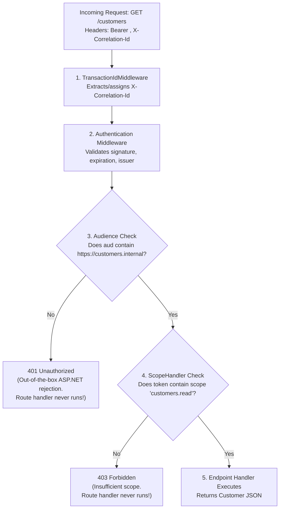

# CustomersApi (`Federated.CustomersApi`)

Resource server exposing customer details (`GET /customers`, `GET /customers/{id}`).

---

## 1. Startup Configuration (Runs ONCE at process boot)

During application startup in `Program.cs`, the host sets up the dependencies and pipeline:

1. **JWT Bearer Registration**:
   Registers `JwtBearerOptions` pointing to `Authority` (`http://localhost:5001`) and `Audience` (`https://customers.internal`). ASP.NET automatically discovers `/.well-known/openid-configuration` and caches public keys from `/.well-known/jwks.json`.
2. **Authorization Policy Registration**:
   Registers the `ScopeHandler` and defines policy:
   ```csharp
   builder.Services.AddAuthorization(options =>
   {
       options.AddPolicy("customers.read", policy => policy.RequireScope("customers.read"));
   });
   ```
3. **Pipeline Construction**:
   Registers `UseTransactionId()` and either `UseCentralCheck()` or `UseAuthentication() / UseAuthorization()` depending on config.
4. **Route Mapping**:
   Maps endpoints with `.RequireAuthorization("customers.read")`.

---

## 2. Request Execution Path (Runs on EVERY Incoming Request)

When a request arrives at `GET /customers`:



### Why Audience Check Happens Before Scope Check:
- **Audience (`aud`) is an authentication boundary**: If an API receives a token that was not issued for it (e.g. `api-a` only asked for orders and inventory), `CustomersApi` considers the token completely invalid for this server. It rejects immediately with **`401 Unauthorized`**.
- **Scope (`scope`) is an authorization boundary**: Once the API verifies the token is intended for this server, `ScopeHandler` inspects if the client is permitted to perform that specific read/write action (**`403 Forbidden`** if missing).
