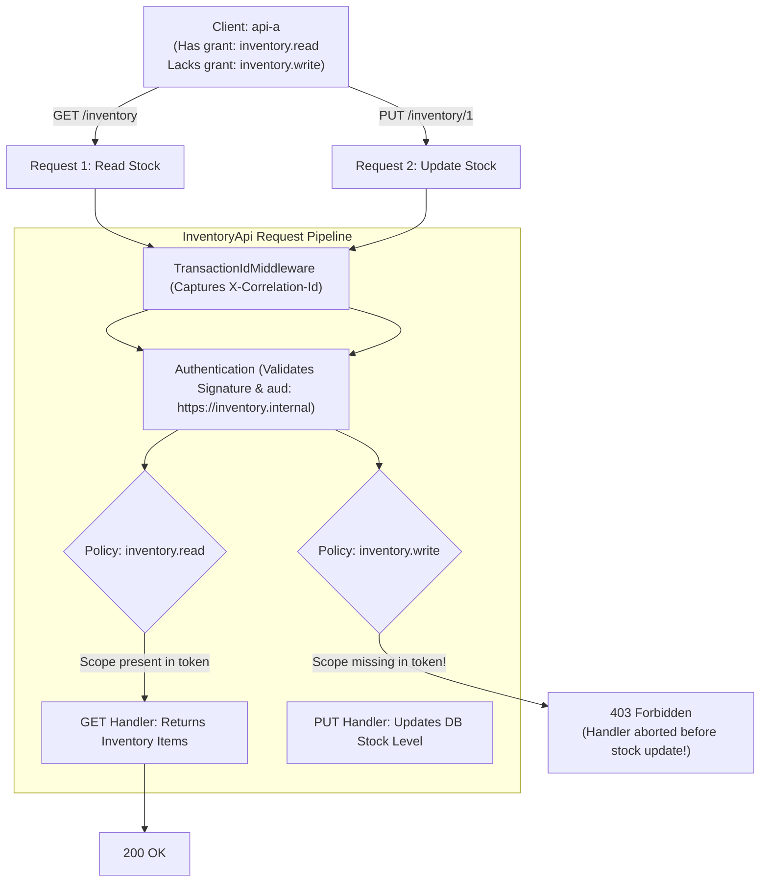

# InventoryApi (`Federated.InventoryApi`)

Resource server exposing inventory stock queries and updates (`GET /inventory`, `PUT /inventory/{id}`).

---

## 1. Startup Configuration (Runs ONCE at process boot)

When `InventoryApi` starts up:
1. **Service Registration**:
   Registers the singleton `ScopeHandler` and two distinct authorization policies:
   - Policy `"inventory.read"` requiring scope `inventory.read`
   - Policy `"inventory.write"` requiring scope `inventory.write`
2. **Middleware Pipeline**:
   `app.UseTransactionId()` is registered, followed by the selected `AuthMode` (`Jwt` or `CentralCheck`).
3. **Route Policies Applied**:
   ```csharp
   app.MapGet("/inventory", ...).RequireAuthorization("inventory.read");
   app.MapPut("/inventory/{id:int}", ...).RequireAuthorization("inventory.write");
   ```

---

## 2. Request Execution Path & Read vs. Write Protection

Here is what happens when two different requests land on `InventoryApi`:



### Key Safety Guarantee:
Because `.RequireAuthorization("inventory.write")` executes in the middleware pipeline **before** the lambda endpoint:
- When a client lacks `inventory.write`, the route handler **never runs**.
- Database state and stock numbers can never be modified by callers lacking write permission.
