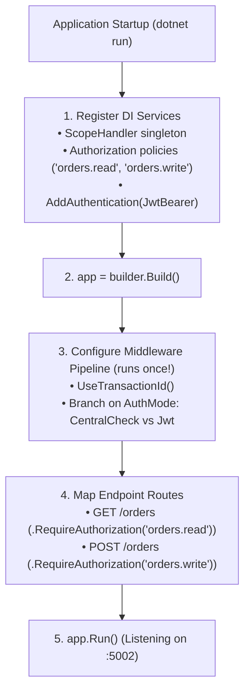
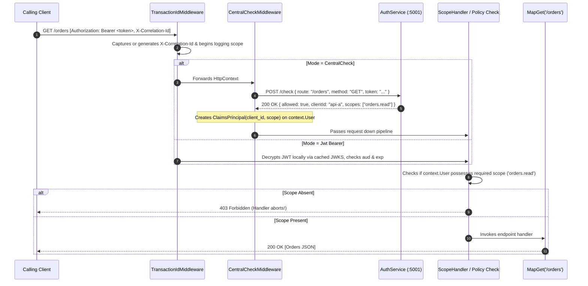

# OrdersApi (`Federated.OrdersApi`)

Resource server exposing protected orders endpoints (`GET /orders`, `GET /orders/{id}`, `POST /orders`).

---

## 1. How It Gets Configured on Application Startup (Runs ONCE)

When the process boots, ASP.NET Core executes `Program.cs` from top to bottom before accepting any incoming HTTP traffic:



### The Middleware Configuration Decision
```csharp
var authMode = builder.Configuration["Authentication:AuthMode"] ?? "Jwt";

if (authMode.Equals("CentralCheck", StringComparison.OrdinalIgnoreCase))
{
    // SETUP 1: Register CentralCheckMiddleware into the HTTP pipeline
    app.UseCentralCheck();
}
else
{
    // SETUP 2: Register standard ASP.NET Core JWT Bearer pipeline
    app.UseAuthentication();
    app.UseAuthorization();
}
```
> **Key concept**: `app.UseCentralCheck()` or `app.UseAuthentication()` is called **only once** at startup. This wires up the delegate chain that every subsequent incoming request travels through.

---

## 2. Request Execution Path (Runs on EVERY Incoming Request)

When a request arrives (e.g. `GET /orders`), here is the exact path it travels:



### Step-by-Step Path Detail:
1. **`TransactionIdMiddleware`**:
   - Inspects `X-Correlation-Id`. If present, keeps it; if absent, creates `Guid.NewGuid()`.
   - Attaches it to response headers and logging context so every subsequent log shares the ID.
2. **Authorization Layer**:
   - In **`CentralCheck`** mode: `CentralCheckMiddleware` sends the request details to `AuthService/check`. If `AuthService` says denied, it immediately responds with `403 Forbidden` and the endpoint code **never runs**. If allowed, it populates `context.User` with claims.
   - In **`Jwt`** mode: ASP.NET Core validates token signature against `AuthService` public keys, validates audience `https://orders.internal` (401 if missing), and extracts claims.
3. **`ScopeHandler` Policy Evaluation**:
   - The route specifies `.RequireAuthorization("orders.read")`.
   - `ScopeHandler` inspects the `scope` claims on `context.User`.
   - If the token lacks `orders.read`, ASP.NET Core halts the request and returns **`403 Forbidden`**. The route handler is never executed.
4. **Endpoint Execution**:
   - Only when all security gates succeed, the lambda handler executes and returns order data.
